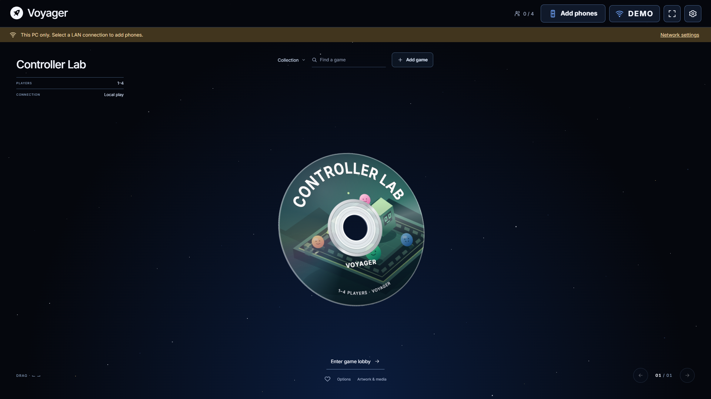
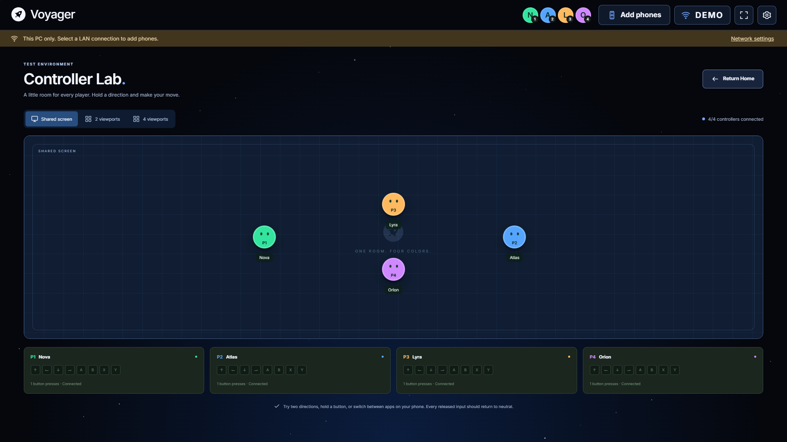
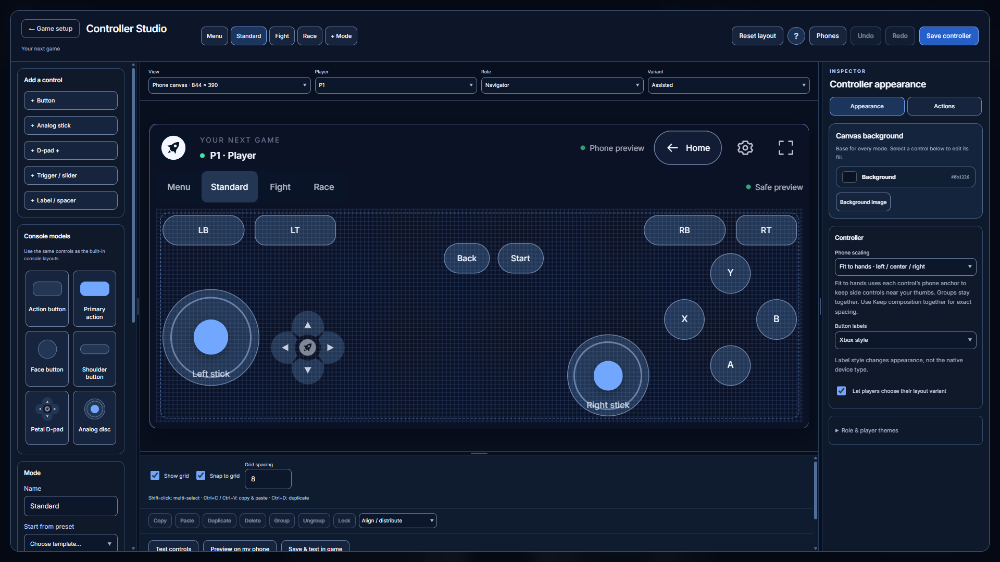
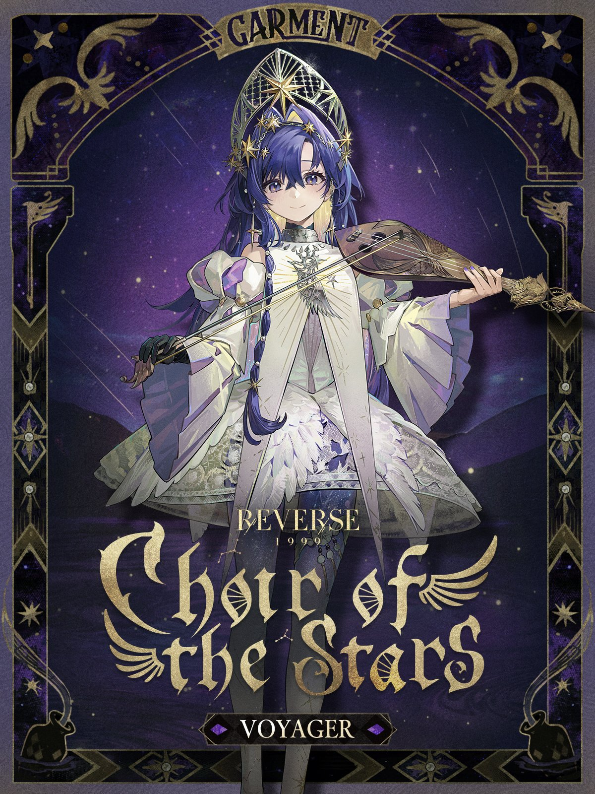

<p align="center">
  
</p>

<h1 align="center">Voyager</h1>
<p align="center"><strong>Your PC is the console. Your phones are the controllers.</strong></p>
<p align="center">An open-source Windows console with a space-inspired disc library and custom phone controllers.</p>
<p align="center">
  <a href="https://github.com/YogurtGen/voyager/releases/latest"></a>
  <a href="LICENSE"></a>
  
</p>
<p align="center">
  <a href="https://yogurtgen.github.io/voyager/">Website</a> ·
  <a href="https://github.com/YogurtGen/voyager/releases/latest">Download</a> ·
  <a href="#start-playing">Quick start</a> ·
  <a href="#add-a-game-with-codex-or-claude-code">Add a game with AI</a> ·
  <a href="CONTRIBUTING.md">Contribute</a>
</p>



**Voyager is open source.** You can inspect, modify and contribute to its MIT-licensed application code. This first public release starts clean: **Controller Lab is the only included game**. No personal game library, installed game, saved controller, pairing session or account is shipped.

Existing users keep their own library when opening this build; it does not erase or redistribute that local data.

## What it does

- **Connect up to four phones.** Join over your private Wi-Fi, scan the QR and approve each phone on the PC. Phones use their browser.
- **Browse a 3D disc collection.** Tilted discs, smooth scene transitions and a minimal black/navy interface keep the collection in focus.
- **Build a controller for each game.** Arrange sticks, D-pads, triggers and buttons in Controller Studio; map actions to supported keyboard or virtual gamepad inputs.
- **Make it yours.** Add local games, artwork and trailers; edit player counts, layouts and mappings. Trailers have Play, Pause, Off, mute and volume controls.
- **Work with Codex or Claude Code.** Give your coding assistant this repository to create game records and purpose-built controllers, or fix Voyager itself.

Controller Lab tests input, simultaneous actions, reconnects and shared/two/four viewport layouts without launching another game. Adding a game requires your own installation and a suitable input mapping; the repository does not include commercial games.

## Download

Get the files from **[GitHub Releases](https://github.com/YogurtGen/voyager/releases/latest)**:

| File                          | Use it for                                                                                      |
| ----------------------------- | ----------------------------------------------------------------------------------------------- |
| `Voyager-Setup-0.1.1-x64.exe` | Install Voyager on Windows 10/11 x64.                                                           |
| `Voyager-0.1.1-x64.zip`       | Portable app. Extract the **whole ZIP**, then run `Voyager.exe`.                                |
| `Voyager-0.1.1-source.zip`    | Source, AI instructions, game toolkit and project launcher. Also available through `git clone`. |
| `SHA256SUMS.txt`              | Verify downloaded files with `Get-FileHash -Algorithm SHA256`.                                  |

The initial build is unsigned, so Windows may show an unrecognized-publisher prompt. The installer offers a private-network firewall rule; it requires administrator approval only if you choose to add that rule. Controller Lab itself does not require a virtual gamepad driver. Some added native games do.

## Start playing

1. Open Voyager on your PC. It starts in fullscreen; **F11** toggles fullscreen.
2. Connect the PC and your phones to the same **private Wi-Fi or hotspot**.
3. Scan the QR, enter a name on the phone, and approve the matching code on the PC.
4. Tap **Enter controller** on the phone, then open **Controller Lab** from Collection.

Only connect devices you trust. A connection marked **This PC only** cannot accept phones; choose a LAN interface in Network settings. Phone haptics depend on browser/device support.

<table>
  <tr>
    <td width="50%"><br><sub>Controller Lab: the included input test.</sub></td>
    <td width="50%"><br><sub>Controller Studio: layout and action editing.</sub></td>
  </tr>
</table>

## Add a game with Codex or Claude Code

The AI runs in **your coding assistant**, with access to this repository and your local game files. Voyager does not contain an AI chat service or ask for an AI API key.

### Set up the editable project

Install Git and **Node.js 24+**, then use PowerShell:

```powershell
git clone https://github.com/YogurtGen/voyager.git
cd voyager
npm run setup
npm start
```

You can also extract the source ZIP and run the last two commands inside its `voyager` folder. After setup, **`Voyager.cmd`** opens the project in fullscreen. When AI edits the source, close Voyager and reopen this launcher: it rebuilds changed code automatically. `Voyager-Windowed.cmd` opens a window for debugging.

**The installer and editable project are separate runtimes.** Adding a game/controller changes library data and does not require reinstalling. Fixing application code affects the project launcher after rebuild; an already installed EXE keeps its packaged code until the new build is applied.

### Give your assistant the project folder

Open the cloned/extracted folder in Codex or Claude Code. Start with a request like:

> Tambahkan game [nama game] dari instalasi lokal saya. Baca AGENTS.md dan docs/AI-WORKFLOW.md. Pahami kontrol aslinya, lalu buat controller HP khusus yang nyaman untuk game ini: layout, analog, tombol, aksi yang ditahan, dan mapping tiap pemain. Simpan dengan toolkit, pertahankan library lama, dan jelaskan apa yang sudah serta belum dites.

Codex reads **[AGENTS.md](AGENTS.md)**; Claude Code reads **[CLAUDE.md](CLAUDE.md)**. Both point to the same **[AI workflow](docs/AI-WORKFLOW.md)**. The assistant should research the actual controls, choose an appropriate layout, and validate the result instead of reusing a generic pad blindly.

### How the assistant saves a game

Close Voyager first. The toolkit creates a schema-correct draft, then validates and saves the completed record:

```powershell
node toolkit/game.mjs --template .local/my-game.json
# The assistant edits the draft's game details, controller and action bindings.
node toolkit/game.mjs .local/my-game.json
```

The save uses Voyager's real library validator, executable checks, revision checks, atomic replacement and previous-catalog backup. Reopen the app to see the new game. You can keep editing it in **Game Edit** and **Controller Studio**.

For an installed app, first choose a library storage folder in Voyager's settings so the app and toolkit use the same location. The assistant must read `%APPDATA%\Voyager\library-location.json` before changing data. See the [storage and installed-app instructions](docs/AI-WORKFLOW.md#find-the-active-library).

AI-generated mappings still need real playtesting. A supported gamepad driver may be needed for virtual controller output, and games can differ in input support, local multiplayer, anti-cheat restrictions and focus behavior.

## Design inspiration & audio credits

Voyager's theme is inspired by **Voyager, the character from [Reverse: 1999](https://re1999.bluepoch.com/)**: dark blue, distant stars, a quiet cosmic mood and music. The rocket/disc mark also nods to the Voyager spacecraft and its Golden Record.

<p align="center">
  
  <br><sub>Voyager — “Choir of the Stars”. Official Reverse: 1999 promotional artwork. © Bluepoch. <a href="https://x.com/Reverse1999_GL/status/1939881645987045654">Original post</a>.</sub>
</p>

**The sampled audio comes from Reverse: 1999.** The startup cue is Voyager's **Select Ultimate**; pairing and collection use the supplied **Login Screen** and **Home Lobby** tracks. Those recordings and the character illustration belong to their original rights holders, including Bluepoch. They are credited separately from the MIT application code and are **not relicensed under MIT**.

This is an independent fan-made project, not an official Bluepoch product. See [media credits](docs/MEDIA-CREDITS.md) and the [asset/dependency inventory](assets/ASSET-LICENSES.md) for source links and license boundaries.

## Development

```powershell
npm run typecheck
npm test
npm run test:workflow
npm run test:controllers
npm run build
npm run test:e2e
```

The Windows build compiles fixed-action native helpers with the .NET Framework C# compiler. The pinned ViGEmClient is a user-mode library; the app does not silently install a driver. Automated tests use isolated libraries and do not launch your commercial games. See [testing](docs/TESTING.md) and [contributing](CONTRIBUTING.md).

## License & acknowledgements

Application source: **[MIT](LICENSE)**. Derived from WaterConsole; existing copyright notices are retained. Thanks to the React, Electron, Fastify, Tabler, Inter/Nunito Sans and ViGEmClient maintainers, and the credited 21st.dev component authors.

Game binaries, user-imported media, Reverse: 1999 recordings and character art retain their owners' rights. The MIT source license does not grant rights to those materials.
